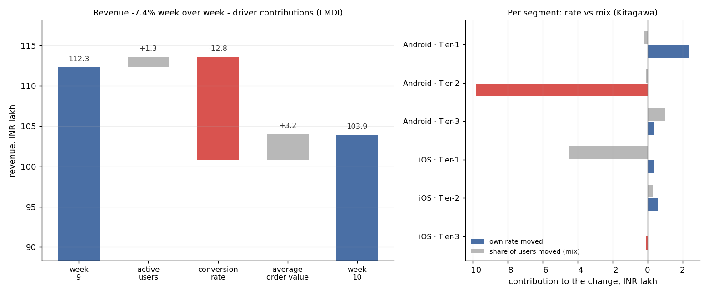

# Why did it move

LMDI driver attribution + Kitagawa rate/mix split on weekly revenue. Explanation written by: none; every number verified against the evidence pack.

## Revenue, week 10 vs week 9

Revenue fell from INR 112.3 lakh to INR 103.9 lakh (-7.4%, -8.3 lakh) in week 10 (02 Nov to 08 Nov) vs week 9 (26 Oct to 01 Nov).
Biggest causes: Android · Tier-2 conversion 3.16% -> 1.82% (-9.9 lakh, 119% of the move); iOS · Tier-1 share of users (mix) 13.9% -> 12.1% (-4.5 lakh, 54.1% of the move).
Not a factor: iOS · Tier-2, iOS · Tier-3 (each under 1 pt of revenue) - stop looking there.

*source: template (no API key)*



<details><summary>evidence</summary>

```json
{
  "metric": "revenue",
  "unit": "INR lakh",
  "before_period": "week 9 (26 Oct to 01 Nov)",
  "after_period": "week 10 (02 Nov to 08 Nov)",
  "before_lakh": 112.3,
  "after_lakh": 103.9,
  "change_lakh": -8.3,
  "change_pct": -7.4,
  "drivers": [
    {
      "driver": "active_users",
      "label": "active users",
      "before": 508931,
      "after": 515018,
      "change_pct": 1.2,
      "contribution_lakh": 1.3,
      "contribution_pct_pts": 1.1
    },
    {
      "driver": "conversion_rate",
      "label": "conversion rate",
      "before": 3.52,
      "after": 3.13,
      "change_pct": -11.2,
      "contribution_lakh": -12.8,
      "contribution_pct_pts": -11.4
    },
    {
      "driver": "avg_order_value",
      "label": "average order value",
      "before": 627,
      "after": 646,
      "change_pct": 3.0,
      "contribution_lakh": 3.2,
      "contribution_pct_pts": 2.8
    }
  ],
  "user_volume_contribution_lakh": 1.3,
  "segments": [
    {
      "segment": "Android \u00b7 Tier-1",
      "users_before": 123242,
      "users_after": 123957,
      "share_before_pct": 24.2,
      "share_after_pct": 24.1,
      "conversion_before_pct": 3.75,
      "conversion_after_pct": 3.95,
      "aov_before": 618,
      "aov_after": 638,
      "rate_contribution_lakh": 2.4,
      "mix_contribution_lakh": -0.2,
      "rate_from_conversion_lakh": 1.5,
      "rate_from_aov_lakh": 0.9
    },
    {
      "segment": "Android \u00b7 Tier-2",
      "users_before": 152306,
      "users_after": 152895,
      "share_before_pct": 29.9,
      "share_after_pct": 29.7,
      "conversion_before_pct": 3.16,
      "conversion_after_pct": 1.82,
      "aov_before": 479,
      "aov_after": 482,
      "rate_contribution_lakh": -9.8,
      "mix_contribution_lakh": -0.1,
      "rate_from_conversion_lakh": -9.9,
      "rate_from_aov_lakh": 0.1
    },
    {
      "segment": "Android \u00b7 Tier-3",
      "users_before": 111391,
      "users_after": 123132,
      "share_before_pct": 21.9,
      "share_after_pct": 23.9,
      "conversion_before_pct": 2.55,
      "conversion_after_pct": 2.56,
      "aov_before": 385,
      "aov_after": 395,
      "rate_contribution_lakh": 0.4,
      "mix_contribution_lakh": 1.0,
      "rate_from_conversion_lakh": 0.1,
      "rate_from_aov_lakh": 0.3
    },
    {
      "segment": "iOS \u00b7 Tier-1",
      "users_before": 70691,
      "users_after": 62349,
      "share_before_pct": 13.9,
      "share_after_pct": 12.1,
      "conversion_before_pct": 5.05,
      "conversion_after_pct": 4.99,
      "aov_before": 977,
      "aov_after": 1000,
      "rate_contribution_lakh": 0.4,
      "mix_contribution_lakh": -4.5,
      "rate_from_conversion_lakh": -0.4,
      "rate_from_aov_lakh": 0.8
    },
    {
      "segment": "iOS \u00b7 Tier-2",
      "users_before": 35802,
      "users_after": 37030,
      "share_before_pct": 7.0,
      "share_after_pct": 7.2,
      "conversion_before_pct": 4.12,
      "conversion_after_pct": 4.29,
      "aov_before": 762,
      "aov_after": 770,
      "rate_contribution_lakh": 0.6,
      "mix_contribution_lakh": 0.3,
      "rate_from_conversion_lakh": 0.5,
      "rate_from_aov_lakh": 0.1
    },
    {
      "segment": "iOS \u00b7 Tier-3",
      "users_before": 15499,
      "users_after": 15655,
      "share_before_pct": 3.0,
      "share_after_pct": 3.0,
      "conversion_before_pct": 3.74,
      "conversion_after_pct": 3.6,
      "aov_before": 611,
      "aov_after": 616,
      "rate_contribution_lakh": -0.1,
      "mix_contribution_lakh": 0.0,
      "rate_from_conversion_lakh": -0.1,
      "rate_from_aov_lakh": 0.0
    }
  ],
  "top_contributors": [
    {
      "name": "Android \u00b7 Tier-2 conversion",
      "contribution_lakh": -9.9,
      "before": "3.16%",
      "after": "1.82%",
      "share_of_change_pct": 119.0
    },
    {
      "name": "iOS \u00b7 Tier-1 share of users (mix)",
      "contribution_lakh": -4.5,
      "before": "13.9%",
      "after": "12.1%",
      "share_of_change_pct": 54.1
    },
    {
      "name": "Android \u00b7 Tier-1 conversion",
      "contribution_lakh": 1.5,
      "before": "3.75%",
      "after": "3.95%",
      "share_of_change_pct": -18.0
    }
  ],
  "did_not_move": [
    "iOS \u00b7 Tier-2",
    "iOS \u00b7 Tier-3"
  ],
  "did_not_move_threshold_pct_pts": 1.0,
  "checks": {
    "driver_sum_gap_lakh": 0.0,
    "segment_sum_gap_lakh": 0.0
  }
}
```
</details>
